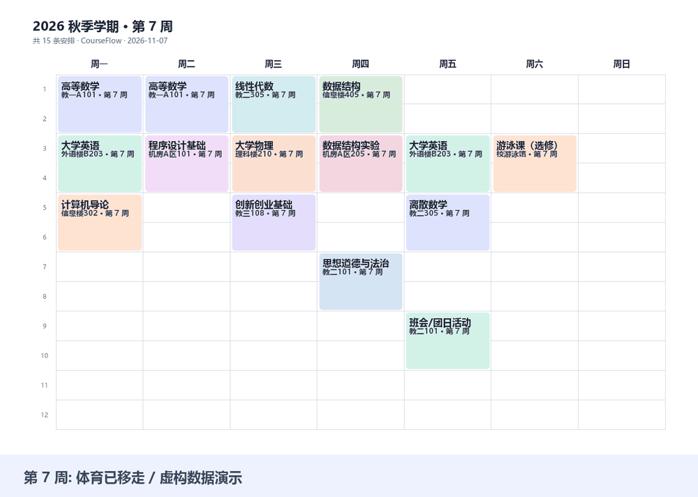

# CourseFlow（课程流）

> 把课表变成每天看得见的壁纸、日历和挂图，也能帮小组找出共同的空闲时间。

CourseFlow turns class timetables into wallpapers, calendars, posters, and shared availability.

面向大学生的本地桌面工具。Excel、粘贴、截图和手动录入都能进入同一份可编辑课表；单双周、停课和跨周调课共用同一套规则。

## 版本说明

本页介绍 **1.0.0 正式版**，包含迭代 5–9 的实现；迭代 0–4 对应历史版本 v0.3。具体功能、验证范围与限制见[本版本更新说明](docs/releases/v1.0.0.md)。实际发布状态和可下载文件以 Releases 页面为准。




*上图使用虚构示例数据生成，展示按周展开后的课程视图，并非屏幕录制。*

## 可以做什么

| 入口 | 功能 |
|---|---|
| 导入 | Excel / CSV / 文字表格、剪贴板、Word 表格、文字 PDF、声明式列映射、截图识别、分步表单 |
| 我的课表 | 应用内周课表网格、切换周次、课程详情、课程列表编辑、学期设置、校对和撤销 |
| 调课 | 手动调整；粘贴通知生成 AI 草稿；同名多课次单选、多选、全选；逐条目标时间；确认后保存 |
| 输出 | 电脑 / 手机壁纸、四款背景与自定义图片、深浅主题、安全边距、`.ics`、A4 PDF / PNG、分享卡 |
| 组队 | 多课表求交、忙闲卡、零安装点格页及 HTML 分享、热力图、会议 `.ics` |
| 快速查看 | 今天、明天、本周和指定周；按课表时区在午夜换日 |

AI 仅用于**截图识别和通知文字解析**。课程校验、冲突判断、忙闲求交和保存由本地程序完成。两个 AI 入口共用一套**具备多模态能力、支持文字和图片识别的接口配置**，使用前检查配置并验证识图能力。

## 运行

源码需要 Python 3.9+ 和 Tk。命令在有 README 的项目根目录运行。已有 Anaconda 的 Windows 用户可直接复用现有 Python 创建项目独立环境：

```powershell
# 将占位路径替换为现有 Anaconda 的 python.exe 路径
.\scripts\bootstrap.ps1 -AnacondaPython "<Anaconda安装目录>\python.exe"
.\Start-CourseFlow.ps1
```

脚本只创建项目内的 `.dev/venv`，不会另装 Python，也不修改 conda base、其他环境或全局 PATH。缓存、临时文件和源码启动器的配置都放在项目 `.dev` 下；将项目放在 D 盘即可让这些内容随项目留在 D 盘。

也可以在自己已有的独立环境中安装并运行：

```bash
python -m pip install -e ".[documents]"
python -m courseflow gui
```

`documents` 是文字 PDF 导入的可选依赖。不需要 PDF 导入时可用 `python -m pip install -e .`。A4 PDF 导出不依赖它。

Windows 便携包需**解压整个文件夹**，双击 `CourseFlow.exe`；不要只复制 exe。下载入口为 [GitHub Releases](https://github.com/inori728/courseflow/releases) / [Gitee Releases](https://gitee.com/yeqi728/courseflow/releases)，请以页面中实际列出的版本和附件为准。`SHA256SUMS.txt` 提供对应下载包的校验值。

公开便携包只包含程序、内置虚构示例、文档和许可证，不预置个人课表、API 配置、使用记录或图片。首次使用请自行导入课表，需要 AI 功能时再配置多模态接口。

详细流程见 [使用说明](docs/使用说明.md)，开发见 [贡献指南](CONTRIBUTING.md) 和 [架构说明](ARCHITECTURE.md)。

## 先用示例试一遍

```bash
python -m courseflow demo -o 输出目录
python -m courseflow check
python -m courseflow wallpaper --week 7 -o 输出目录
python -m courseflow calendar -o 输出目录/课表.ics
python -m courseflow poster --week 7 -o 输出目录/本周挂图.pdf
python -m courseflow today
```

`demo` 在当前目录生成 `课表.yaml`，已有文件默认不会覆盖。示例有一处故意保留的重叠，用来体验校对。CLI 壁纸和日历默认输出到桌面，可用 `-o` 自选位置；GUI 会让你选择保存位置。项目开发和依赖下载优先使用 D 盘，不会因此更改用户选择的导出路径。

## AI 设置与通知调课

在 GUI「AI 接口设置」填写兼容 Chat Completions 的地址、模型名和提供方要求的 Key，点击「保存并自检」。自检会发送一张程序生成的数字图片，读取正确才通过；纯文本模型不满足要求。支持自定义兼容接口和本地 Ollama，模型须自行具备视觉能力。

CLI 可交互输入 Key，避免写进命令历史：

```bash
term config-ai --base-url https://你的接口地址/v1 --model 你的多模态模型 --prompt-key --test
term vision 课表截图.png -o 识图结果.ai-draft.json
# 人工校对草稿后再确认保存
term accept 识图结果.ai-draft.json --confirm -o 课表.yaml

term notice "把第7周的体育课调到第9周周五下午两点, 时长和地点不变."
term notice-preview 通知.proposal.json --select 1
# 看过预览且没有新增冲突后才实际保存
term notice-preview 通知.proposal.json --select 1 --apply --confirm
```

同名课有两次时会列出星期、节次和地点让你选择。全选分别调整每一次课；若都移到同一时间则阻止保存，需逐条修改目标。钟点必须能对应课表作息；缺少星期、周次或无法对应节次时要求补充，不猜学校作息。

GUI 的“确认修改当前课表”会直接更新并保存当前课表，随后在“我的课表”切到目标周和相关节次查看结果，不要求另存一份文件。“保存当前课表”同样直接保存；需要另一份文件时才选“另存为”。保存后会记住当前课表位置，下次打开继续使用。壁纸和日历是可选输出，平时直接在应用内看即可。

## 课表源文件

`课表.yaml` 是普通文本，旧版仍可读取。GUI 中的学期设置对应以下字段：

```yaml
semester_start: 2026-09-07 # 第 1 周周一
weeks_total: 16
timezone: Asia/Shanghai
period_times:
  1: 08:00-08:45
  2: 08:50-09:35
  # 按学校作息填写其余节次
courses:
- name: 体育
  day: 周二
  periods: 1-2
  weeks: 1-16周
  room: 操场
  skip: [8]
  changes:
  - week: 7
    target_week: 9
    day: 周五
    periods: 1-2
```

这表示第 8 周停课，第 7 周的课移到第 9 周周五。**第 9 周原有的周二课保留**；省略 `target_week` 则在原周调整。跨周数据保存为 schema 3，旧版本不理解 `target_week`，请用当前版本继续处理。

单周/双周照原文写入 `weeks`。连堂写成 `periods: 3-4`，会生成一个整段日历事件；两条独立记录不自动合并。学期总览显示原始安排；指定周视图、日历、今日课程和组队使用调整后的实际安排。

## 组队

```bash
term busycard -f 课表.yaml --name 小林 --week 7 -o 小林.busycard
term group 小林.busycard 小陈.busycard --week 7 -o 组队结果
term meeting 小林.busycard 小陈.busycard --week 7 --day 周日 --periods 3-4 -o 讨论.ics
term point-grid -o 忙闲点格页.html
```

忙闲卡只包含名称、学期、作息和忙闲格，不包含课程名称与教室；它是可解码的短码，**并非加密文件**。卡片没有提供的周次会要求补充，不能当作空闲。不同学期按实际日期对齐，作息或时区不一致会提示处理。没有作息表时可按节次求交，导出会议日历仍须补齐时间。

GUI 先把课表或忙闲卡加入左侧成员列表，再选周次和最少连续节数查找。热力图绿色表示全员空闲，“N 人忙”表示这一节有 N 位成员忙碌；至少连续 2 节按学校节次计算。各按钮的用途和完整示例见[组队使用说明](docs/使用说明.md#6-组队找空闲)。

组队页的“分享点格页”会保存一份独立 HTML 文件，发给成员后用浏览器打开即可填写。页面预填当前查询周、学期日期和已有作息；没有个人课表时可沿用已加入成员的学期信息，不携带成员姓名或忙碌格。成员填完后把 `.busycard` 或短码发回，组长再导入求交。

点格页也提供 `docs/index.html` 静态托管源文件；当前未部署线上页面。分享的是 HTML 文件，手机端打开方式受浏览器和聊天应用限制；线上网址须审查批准后另行部署。页面不请求外部脚本、没有账号、不会代用户发送文件。

## 数据与限制

- 使用云端 AI 时，所选图片或通知及必要的课程上下文会发送到**你配置的接口**；普通导入、编辑、输出和组队不联网。若要求图片不离开电脑，使用本地多模态模型。
- API Key 保存在本机；Windows 使用当前用户 DPAPI 加密，其他系统使用本地权限限制。配置、个人课表、草稿和忙闲卡默认不纳入仓库。
- AI 可能看错，截图学期日期和作息仍需核对。文字 PDF / Word 仅处理可提取的表格文字，扫描 PDF 请转为图片识别。列映射针对逐行课程记录，不承诺自动理解所有学校格式。
- 内置放假数据仅覆盖 2026 年，来源及许可见 [数据说明](courseflow/data/README.md)。`term holidays` 只提醒，不自动改课；在线更新未实现。
- 当前按每天 12 节表示课程；任意钟点须先映射到学校节次。课程调整后应重新导出文件，已导入第三方日历的旧事件不会由本工具远程删除。
- Windows 便携包未签名。验证范围与已知限制见本版本更新说明。

## 选题与路线

**问题**：很多同学只有教务系统截图或不便处理的表格。希望从这些材料开始，把可校对的课表变成壁纸、日历、挂图，并用同一套规则解决组队找时间。

**为什么开源**：这是《基础软件与开源系统》的课程项目，采用敏捷开源方式，保留可验证的迭代、测试与维护记录。

**可能的扩展点**：更多学校格式适配、更好的文字排版和实际使用反馈。学期设置 AI 助手等其他 AI 方案尚未纳入范围。

| 迭代 | 内容 | 本版本状态 |
|---|---|---|
| 0–4 | 基础导入、校对、单双周、日历、放假提醒 | 已发布至 v0.3 |
| 5 | 识图草稿与多模态自检 | 已实现 |
| 6 | 应用内周课表、课程列表与图形编辑 | 已实现 |
| 7 | 通知解析、候选选择与确认 | 已实现 |
| 8 | 组队、忙闲卡和点格页 | 已实现；页面未部署 |
| 9 | 个性化输出、挂图、文档、图标与 Windows 打包 | 已实现 |

## 许可证

[MIT](LICENSE) · Copyright (c) 2026 yeqi。第三方依赖与打包说明见 [THIRD_PARTY.md](THIRD_PARTY.md)。
